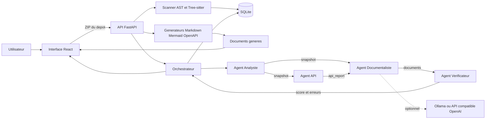
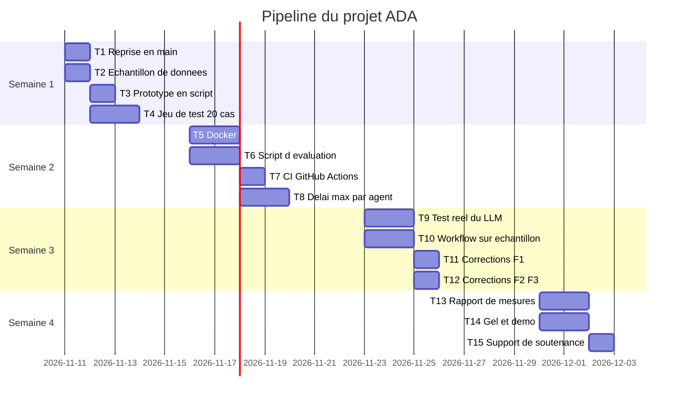

# Dossier de lancement (semaine 1)

Projet : **AI Documentation Agent (ADA)**, agent de documentation automatique de dépôts de code
Équipe (binôme) : **Elhamss Med Mounir** (membre A) et **Salah Mouad** (membre B)
Date : 11 novembre 2026

## Notre répartition

| Livrable | Rédacteur | Relecteur | Fichier dans le dépôt |
| --- | --- | --- | --- |
| 1. Descriptif du projet | Elhamss Med Mounir | Salah Mouad | `docs/semaine1/1-descriptif.md` |
| 2. Dataset | Salah Mouad | Elhamss Med Mounir | `docs/semaine1/2-dataset.md` + `data/sample/` |
| 3. Maquette globale | Elhamss Med Mounir | Salah Mouad | `docs/semaine1/3-maquette.md` + `docs/semaine1/img/` |
| 4. Pipeline des tâches | Salah Mouad (consolidation) | Elhamss Med Mounir | `docs/semaine1/4-pipeline.md` |

Répartition conforme au tableau « 2 étudiants » : A = livrables 1 et 3, B = livrables 2 et 4. Chacun a saisi ses propres tâches dans le livrable 4.

---

## Livrable 1 : descriptif du projet mis à jour

Rédacteur : Elhamss Med Mounir   Relecteur : Salah Mouad   Fichier : `docs/semaine1/1-descriptif.md`

**1.1 Contexte et problème.** Dans les petites équipes et les projets étudiants, la documentation d'un dépôt (README, architecture, description des modules, contrat d'API) est écrite à la main, tard, et devient vite obsolète dès que le code change. Les développeurs qui reprennent un dépôt inconnu doivent lire le code pour comprendre sa structure et ses routes. L'agent analyse un dépôt importé en ZIP, sans exécuter son code, et produit une documentation fidèle à ce qui est réellement dans le code.

**1.2 Objectif.** Obtenir, à partir d'une archive ZIP de dépôt, une documentation technique (README, architecture Mermaid, fiches de module, OpenAPI) générée en quelques secondes et contrôlée automatiquement contre le code source.

**1.3 Utilisateurs cibles et scénario d'usage principal.** Utilisateurs : développeurs, étudiants et enseignants qui reprennent ou évaluent un dépôt. Scénario :

1. L'utilisateur ouvre l'interface et importe l'archive ZIP de son dépôt (page « Importer »).
2. Il lance l'analyse et suit son état jusqu'à la fin (inventaire des fichiers, symboles, routes).
3. Il lance la génération : README, architecture, modules et OpenAPI sont produits.
4. Il lance le workflow multi-agents : les documents sont recalculés par quatre agents, puis contrôlés par le Vérificateur (score et erreurs).
5. Il consulte les documents dans l'interface et télécharge l'archive documentaire.

**1.4 Fonctionnalités du MVP** (binôme : 2 à 3)

| N° | Fonctionnalité | Ce que l'utilisateur voit ou obtient | Priorité |
| --- | --- | --- | --- |
| F1 | Import ZIP sécurisé et analyse statique | Un inventaire du dépôt : fichiers, symboles (fonctions, classes), routes API, graphe d'imports, avec avertissements (fichiers sensibles ignorés, syntaxe non analysée) | Indispensable |
| F2 | Génération de documentation déterministe | Un lot de documents Markdown : README, architecture avec diagramme Mermaid, fiches de module, OpenAPI valide, téléchargeable en archive | Indispensable |
| F3 | Workflow multi-agents avec vérification | Une exécution orchestrée (Analyste, API, Documentaliste, Vérificateur) avec trace des échanges, état par agent et score de conformité des documents | Indispensable |

**1.5 Services et composants techniques**

| Service ou composant | Rôle dans le projet | Technologie choisie | Pourquoi ce choix |
| --- | --- | --- | --- |
| Modèle (LLM ou ML) | Explications complémentaires par module, marquées « générée par IA, à valider » ; optionnel | Ollama (`llama3.1`) ou API compatible OpenAI, désactivé par défaut (`ADA_LLM_PROVIDER=none`) | Le mode déterministe reste la référence ; le LLM ne sert qu'à enrichir, avec repli automatique s'il échoue |
| Recherche ou mémoire | Conserver projets, analyses, symboles, routes, générations et exécutions d'agents | SQLite via SQLAlchemy ; pas de base vectorielle | L'analyse statique n'a pas besoin de recherche sémantique ; SQLite suffit pour un usage local mono-utilisateur |
| Outils appelés par l'agent | Extraire la structure du code et valider les sorties | `ast` (Python), Tree-sitter (JS, TS, PHP, Java, C#, Go, Rust, Ruby), Jinja2, `openapi-spec-validator` | Analyse fiable sans exécuter le code importé ; validation objective des documents produits |
| API | Exposer import, analyse, génération, comparaison, agents (21 routes) | FastAPI | Imposé ; documentation Swagger automatique |
| Interface | Importer, suivre, consulter les documents et lancer les agents | React 18, TypeScript, Vite, Tailwind, Mermaid | Déjà en place et testée (Vitest) ; rendu direct des diagrammes Mermaid |
| Conteneur et intégration continue | Reproduire l'installation et valider chaque pull request | Docker, GitHub Actions | Imposé ; **à créer** : aucun Dockerfile ni workflow dans l'archive analysée (voir 1.7) |

**1.6 Hors périmètre.**

- Authentification, multi-utilisateur et isolation des projets (l'outil reste local).
- Analyse sémantique du HTML, CSS, SCSS et SQL (inventaire seulement).
- Exécution du code importé, et dépôts de plus de 50 Mio ou 5 000 fichiers.
- Évaluation rigoureuse des textes générés par LLM : le mode déterministe est le seul mode mesuré.
- Nouveaux développements sur la comparaison de versions, les snapshots et la restauration : ces fonctions existent déjà, elles sont conservées sans être évaluées.

**1.7 Écart avec la fiche du catalogue.** Nous n'avons pas la fiche du catalogue sous les yeux au moment de la rédaction : **à compléter ou confirmer avec l'enseignant**. Ce qui est établi par l'analyse du dépôt : le code existe déjà (version 0.2.0, 59 tests backend réussis, 15 tests frontend déclarés). Le travail des 4 semaines porte donc sur ce qui manque pour un livrable complet : conteneurisation Docker, intégration continue (le README cite `.github/workflows/ci.yml`, absent de l'archive), jeu de test et mesures de qualité, test réel du fournisseur LLM (jamais exécuté contre un vrai service), délai maximal par agent (limite connue).

**Critères d'acceptation (vérifiés par le relecteur)**

- [ ] Le problème et l'utilisateur sont compréhensibles sans le catalogue.
- [ ] Le nombre de fonctionnalités correspond à la taille de l'équipe (3 pour un binôme).
- [ ] Chaque fonctionnalité est démontrable (pas de formulation vague comme « améliorer »).
- [ ] Chaque composant technique a une justification d'une ligne.
- [ ] Le hors périmètre est rempli.

---

## Livrable 2 : dataset

Rédacteur : Salah Mouad   Relecteur : Elhamss Med Mounir   Fichiers : `docs/semaine1/2-dataset.md` + `data/sample/`

Pour un agent de documentation de code, les « données » sont des **dépôts de code source** fournis en ZIP.

**2.1 Description**

| Rubrique | Réponse |
| --- | --- |
| Nom et source (lien) | Corpus de dépôts logiciels. (a) Fixture de l'équipe `backend/fixtures/demo_project`. (b) `fastapi/full-stack-fastapi-template` : https://github.com/fastapi/full-stack-fastapi-template (licence MIT vérifiée via l'API GitHub). (c) Deux ou trois petits dépôts publics supplémentaires (Flask, Express, etc.) **à sélectionner et dont la licence reste à vérifier** avant de les ajouter |
| Producteur ou propriétaire | (a) l'équipe ; (b) projet FastAPI (Sebastián Ramírez et contributeurs) ; (c) leurs mainteneurs respectifs |
| Volume | (a) 4 fichiers ; (b) 248 fichiers dans le dépôt, 2,7 Mo sans l'historique Git ; échantillon total visé inférieur à 10 Mo |
| Format et structure | Archives ZIP de code : Python (FastAPI), TypeScript/React, Markdown, YAML, Dockerfile. Aucune colonne : ce sont des arborescences de fichiers |
| Langue et période couverte | Code en anglais, commentaires et README en anglais, fixture en français et anglais ; dépôts actifs en 2024 à 2026 |
| Licence et droits d'usage | (a) propriété de l'équipe ; (b) MIT, usage libre dans un projet de cours avec mention de la licence ; (c) à vérifier un par un, on n'ajoute que des licences MIT, BSD ou Apache-2.0 |
| Données personnelles ou sensibles, et traitement prévu | Aucune donnée personnelle intentionnelle. Risque : fichiers `.env` ou secrets dans un dépôt. Traitement : le scanner les ignore déjà (testé : `.env` et `frontend/.env` ignorés sur le dépôt b) ; on ne dépose dans `data/sample/` que des dépôts publics |
| Emplacement des données complètes | Échantillon dans `data/sample/` (moins de 10 Mo) ; dépôts d'origine sur GitHub, téléchargeables à la demande, sans stockage dans Git |

**2.2 Qualité constatée sur l'échantillon.** Mesures faites avec `ada scan` sur deux éléments de l'échantillon :

- Fixture : 4 fichiers analysés, 6 symboles, 1 route. Propre, mais trop petite pour mesurer quoi que ce soit.
- Dépôt (b) : 244 fichiers analysés sur 248, 390 symboles, 23 routes détectées. Avertissements : 2 fichiers `.env` ignorés (comportement voulu) et 1 fichier Python non analysé (`backend/app/api/deps.py`, ligne 36, syntaxe non reconnue). Ce dernier point est un vrai défaut à étudier.
- Déséquilibre : l'échantillon est dominé par Python/FastAPI ; JS, PHP, Go, etc. sont couverts uniquement par des tests unitaires, pas par de vrais dépôts. HTML, CSS et SQL ne sont qu'inventoriés. Les fichiers de plus de 2 Mio sont ignorés par conception.

**2.3 Justification**

| Fonctionnalité | Données utilisées | En quoi elles suffisent |
| --- | --- | --- |
| F1 | Fixture + dépôt (b) + 2 à 3 dépôts publics | Couvrent Python, TypeScript et plusieurs frameworks ; on peut compter à la main routes et symboles attendus et comparer |
| F2 | Mêmes dépôts | Contiennent routes et modules réels pour générer et valider README, Mermaid et OpenAPI |
| F3 | Mêmes dépôts | Permettent de comparer le score du Vérificateur et les erreurs d'un dépôt à l'autre, et de provoquer des échecs d'agent (dépôt vide, archive invalide) |

**2.4 Alternative de repli.** Si un dépôt public devient inaccessible : utiliser uniquement la fixture de l'équipe, déjà dans le dépôt (toujours accessible), complétée par des mini-dépôts synthétiques écrits par l'équipe (un par framework : FastAPI, Flask, Django, Express, Laravel). Perte : moins de réalisme (pas de code complexe ni de bruit), donc des mesures moins représentatives. Seul le lien du dépôt (b) a été vérifié à ce jour ; les liens des dépôts (c) seront vérifiés avant fusion.

**2.5 Jeu de test.** 20 cas au minimum :

- 8 mini-dépôts synthétiques écrits par l'équipe : un par framework (FastAPI, Flask, Django, Express, Laravel) plus des cas pièges (import relatif, secret dans un fichier, lien symbolique, ZIP avec traversée de chemin).
- 8 dépôts publics de petite taille avec licence compatible.
- 4 cas de régression : même dépôt avant et après modification, pour la comparaison et la détection d'obsolescence.

Réponses attendues rédigées par l'équipe (Salah pour le comptage des routes et symboles, Elhamss pour la relecture croisée) : nombre et liste des routes (méthode + chemin), symboles principaux, documents obligatoires attendus. Indicateurs : précision et rappel des routes détectées, part des symboles retrouvés, score du Vérificateur, temps d'analyse, taux de réussite du workflow.

**Critères d'acceptation (vérifiés par le relecteur)**

- [ ] L'échantillon est dans `data/sample/` et s'ouvre sans erreur.
- [ ] La licence autorise l'usage dans un projet de cours.
- [ ] Les données personnelles éventuelles sont anonymisées ou remplacées par des données fictives.
- [ ] Chaque fonctionnalité du MVP est couverte par la justification.
- [ ] L'alternative de repli est réellement accessible (lien vérifié).
- [ ] Le jeu de test est défini, même partiellement rédigé.

---

## Livrable 3 : maquette globale

Rédacteur : Elhamss Med Mounir   Relecteur : Salah Mouad   Fichiers : `docs/semaine1/3-maquette.md` + `docs/semaine1/img/`

**3.1 Schéma d'architecture**

**3.2 Légende du schéma**

| Composant | Rôle | Fonctionnalité |
| --- | --- | --- |
| Interface React | Import, suivi, consultation des documents, bouton « Workflow multi-agents » | F1, F2, F3 |
| API FastAPI | Point d'entrée : import, analyse, génération, agents | F1, F2, F3 |
| Scanner AST et Tree-sitter | Extrait fichiers, symboles, routes, imports sans exécuter le code | F1 |
| SQLite | Conserve projets, analyses, symboles, générations, exécutions d'agents | F1, F2, F3 |
| Générateurs | Produisent README, architecture, modules, OpenAPI | F2 |
| Orchestrateur | Distribue les tâches, relance les échecs transitoires, isole les erreurs, trace les échanges | F3 |
| Agent Analyste | Produit le `snapshot` du dépôt (bloquant) | F3 |
| Agent API | Identifie les endpoints et valide l'OpenAPI (non bloquant) | F3 |
| Agent Documentaliste | Génère les documents, enrichissement IA optionnel (bloquant) | F2, F3 |
| Agent Vérificateur | Contrôle la cohérence des documents et calcule le score (non bloquant) | F3 |
| LLM optionnel | Explications par module, avec repli déterministe | F2, F3 |

**3.3 Maquette des écrans.** Ces écrans existent déjà dans l'interface (routes `/`, `/upload`, `/projects/:id`, `/projects/:id/agents`). Les captures seront prises depuis l'application et déposées dans `docs/semaine1/img/` (**à faire avant la pull request**).

| Écran | Image | Fonctionnalités affichées | Action principale de l'utilisateur |
| --- | --- | --- | --- |
| Importer un projet (`/upload`) | `img/01-import.png` | F1 | Choisir un ZIP et lancer l'import |
| Page projet (`/projects/:id`) | `img/02-projet.png` | F1, F2 | Lancer l'analyse, générer, lire README, architecture et OpenAPI, télécharger |
| Workflow multi-agents (`/projects/:id/agents`) | `img/03-agents.png` | F3 | Lancer le workflow, lire l'état par agent, la trace et le score |
| Tableau de bord (`/`) | `img/04-dashboard.png` | F1, F2 | Voir les projets et l'état des traitements |

**3.4 Parcours utilisateur.** Tableau de bord, puis « Importer » (choix du ZIP, import), puis page projet (analyse, suivi de l'état, inventaire), puis génération (documents affichés avec le diagramme Mermaid), puis écran « Workflow multi-agents » (exécution, trace, score du Vérificateur), puis téléchargement de l'archive documentaire depuis la page projet.

**Critères d'acceptation (vérifiés par le relecteur)**

- [ ] Chaque composant du livrable 1 apparaît dans le schéma, et inversement.
- [ ] Le parcours d'une requête se suit de bout en bout sur le schéma.
- [ ] Chaque fonctionnalité du MVP est visible sur au moins un écran.
- [ ] Le schéma s'affiche correctement sur GitHub (Mermaid valide ou image présente).
- [ ] Pour une équipe de 4 : sans objet (binôme).

---

## Livrable 4 : pipeline des tâches prévues

Consolidateur : Salah Mouad   Relecteur : Elhamss Med Mounir   Fichier : `docs/semaine1/4-pipeline.md`

Dates : semaine 1 = 9 au 13 novembre, semaine 2 = 16 au 20, semaine 3 = 23 au 27, semaine 4 = 30 novembre au 4 décembre (**à ajuster aux dates réelles de l'enseignant**). Les tâches de rédaction du dossier de la semaine 1 ne sont pas comptées ci-dessous et se répartissent à égalité.

**4.1 Liste des tâches**

| ID | Tâche | Fonctionnalité | Responsable | Dépend de | Semaine | Terminée quand ? (critère vérifiable) |
| --- | --- | --- | --- | --- | --- | --- |
| T1 | Reprise en main : installer l'environnement, lancer les tests et la CLI `ada` (1 j) | F1 | Elhamss | n/a | 1 | `pytest` affiche 59 réussis et `ruff` est propre sur la machine de chaque membre |
| T2 | Constituer `data/sample/` : fixture + dépôt (b) + 2 dépôts publics, licences vérifiées (1 j) | F1 | Salah | n/a | 1 | `ada scan` s'exécute sans erreur sur chaque élément et le dossier fait moins de 10 Mo |
| T3 | Prototype en script : `ada generate` sur tout l'échantillon, sorties archivées (1 j) | F2 | Elhamss | T1, T2 | 1 | Les documents de chaque dépôt sont générés et `ada check` ne signale aucune erreur |
| T4 | Rédiger les 20 cas du jeu de test avec réponses attendues (2 j) | F1, F2 | Salah | T2 | 1 | `data/tests/cases.json` contient 20 cas, relu par Elhamss |
| T5 | Écrire le Dockerfile et `docker compose` backend + frontend (2 j) | F1, F2, F3 | Elhamss | T3 | 2 | `docker compose up` : `/api/health` répond 200 et l'interface s'ouvre |
| T6 | Script d'évaluation : précision et rappel des routes, symboles retrouvés (2 j) | F1 | Salah | T4 | 2 | `python eval.py` imprime un tableau chiffré sur les 20 cas |
| T7 | Workflow GitHub Actions : ruff, pytest, vitest, build, build Docker (1 j) | F1, F2, F3 | Elhamss | T5 | 2 | Une pull request de test affiche tous les contrôles au vert |
| T8 | Ajouter un délai maximal par agent et son test (2 j) | F3 | Salah | T3 | 2 | Un agent volontairement lent est interrompu et marqué en échec dans la trace ; test pytest ajouté |
| T9 | Test réel du fournisseur LLM (Ollama en local) sur 3 dépôts (2 j) | F2 | Elhamss | T7 | 3 | Les explications générées apparaissent, marquées « générée par IA », et un arrêt d'Ollama déclenche le repli sans erreur |
| T10 | Exécuter le workflow multi-agents sur tout l'échantillon, relever scores et traces (2 j) | F3 | Salah | T8 | 3 | Tableau score / durée / statut pour chaque dépôt dans `docs/` |
| T11 | Corriger les écarts F1 relevés par T6, dont le fichier non analysé `deps.py` (1 j) | F1 | Elhamss | T6 | 3 | Le fichier est analysé ou l'avertissement est expliqué, et le rappel mesuré augmente |
| T12 | Corriger les écarts F2 et F3 relevés par T10 (1 j) | F2, F3 | Salah | T6, T10 | 3 | Aucun dépôt de l'échantillon ne produit d'erreur du Vérificateur |
| T13 | Rapport de mesures final : indicateurs, limites, comparaison avant/après (2 j) | F1, F2, F3 | Salah | T11, T12 | 4 | Rapport relu avec les chiffres de `eval.py` |
| T14 | Gel du code, README et STATUS à jour, répétition de la démo (2 j) | F1, F2, F3 | Elhamss | T11 | 4 | Étiquette de gel posée, démo déroulée sans erreur de bout en bout |
| T15 | Support de soutenance (1 j) | F1, F2, F3 | Elhamss | T14, T13 | 4 | Support relu par Salah |

**4.2 Jalons hebdomadaires**

| Semaine | Jalon démontrable | Tâches qui y mènent |
| --- | --- | --- |
| 1 | Dossier de lancement fusionné, prototype en script | T1, T2, T3, T4 |
| 2 | Agent exposé par l'API, premiers tests | T5, T6, T7, T8 |
| 3 | MVP complet, Docker et CI au vert | T9, T10, T11, T12 |
| 4 | Résultats mesurés, code gelé, soutenance | T13, T14, T15 |

**4.3 Vue chronologique**

**4.4 Chemin critique et charge**

- Chaîne de tâches dont le moindre retard décale la soutenance : T2, T4, T6, T11, T13 (échantillon, jeu de test, mesure, corrections, rapport). Chaîne parallèle à surveiller : T3, T8, T10, T12, T13.
- Charge par membre : Elhamss 11 jours (T1, T3, T5, T7, T9, T11, T14, T15), Salah 12 jours (T2, T4, T6, T8, T10, T12, T13). Écart : 1 jour.

**Critères d'acceptation (vérifiés par le relecteur)**

- [ ] Aucune tâche ne dépasse 2 jours.
- [ ] Chaque fonctionnalité du MVP a au moins une tâche, et chaque tâche a un critère de fin vérifiable.
- [ ] Le MVP est complet au plus tard en fin de semaine 3.
- [ ] Chaque membre a saisi ses propres tâches ; l'écart de charge entre membres reste inférieur à 2 jours.
- [ ] Les tâches existent comme issues GitHub (**à créer : T1 à T15**).

---

## Remise et décision de l'enseignant

**Checklist de remise (coordinateur)**

- [ ] `docs/semaine1/README.md` avec la répartition rédacteurs et relecteurs
- [ ] Les quatre livrables fusionnés sur la branche principale, chacun par une pull request approuvée par son relecteur
- [ ] Échantillon de données dans `data/sample/`
- [ ] Schéma et écrans visibles sur GitHub
- [ ] Issues GitHub créées pour les tâches du pipeline
- [ ] Étiquette `semaine1-remis` posée et enseignant prévenu

**Décision de l'enseignant (sous 48 heures)** : réservé à l'enseignant, à laisser tel quel.

| Critère | Type | Respecté | Commentaire |
| --- | --- | --- | --- |
| Données accessibles et échantillon présent (L2) | Bloquant | ☐ |  |
| MVP réaliste en 4 semaines pour cette taille d'équipe (L1, L4) | Bloquant | ☐ |  |
| Livrables répartis, chacun avec un rédacteur et un relecteur distincts | Bloquant | ☐ |  |
| Licence et données personnelles traitées (L2) | Bloquant | ☐ |  |
| Architecture cohérente avec les fonctionnalités (L1, L3) | À améliorer | ☐ |  |
| Écrans couvrant tout le MVP (L3) | À améliorer | ☐ |  |
| Tâches courtes, critères de fin vérifiables, charge équilibrée (L4) | À améliorer | ☐ |  |
| Alternative de repli et jeu de test définis (L2) | À améliorer | ☐ |  |

**Décision** : ☐ Validé   ☐ À reprendre   ☐ Refusé (changement de sujet)

Date et visa : ____________________

**Lien avec l'évaluation.** Ce dossier sert de référence pour le critère P1 (respect du cadrage) et alimente P3 (jeu de test et indicateurs) et P7 (pipeline et suivi). La répartition et les pull requests de chaque membre comptent comme preuves pour le coefficient individuel.
